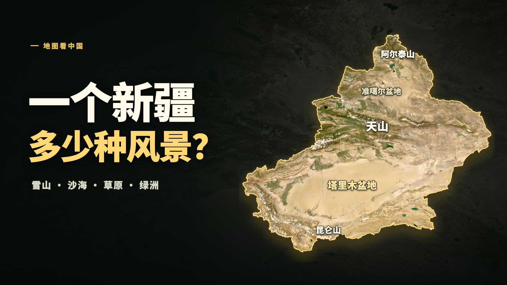

# 新疆，为什么能同时拥有雪山、沙漠和草原？

「地图里的中国」新疆篇 · 横屏 Exodus 配乐版



雪山旁边是沙海，荒漠边缘却连着绿洲和城市。从“三山夹两盆”出发，沿着天山的水、伊犁的风和独库公路，用动态地图读懂新疆的山河。

## 完整视频

- [下载 MP4 原文件](https://github.com/duzhe123-A/xinjiang-geography-video/releases/download/v1.0.0/xinjiang-exodus.mp4)
- [查看发布页与全部附件](https://github.com/duzhe123-A/xinjiang-geography-video/releases/tag/v1.0.0)
- 文件大小：416,918,475 字节（约 417 MB）
- 本次发布保留原文件的全部画面、配音、字幕及配乐，未重新编码。

## 内容与素材署名

本片含 AI 合成本人旁白与地图动画。

- 地图影像：Esri、Vantor、Earthstar Geographics、GIS User Community
- 行政边界：DataV GeoAtlas
- 河流水系：Natural Earth
- 音乐：Exodus — MAKSIM（马克西姆）
- 山脉、盆地范围及公路线路为说明性示意。

本仓库公开展示成片及相关发布资料。音乐、地图影像等第三方素材的权利归各自权利人所有，公开展示不授予这些素材的再授权。

## 文件校验

视频 SHA-256：

```text
5609e1ead71de843fe45d91f6f74840ec5b0db13b54eb00b2b4f06e65563b929
```

Release 中附有 `SHA256SUMS.txt`。封面及标题文案分别见 `cover.png`、`POST_COPY.txt`。
